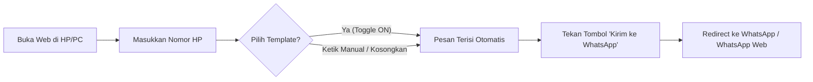

# 📦 WhatsApp Tap Chat

<p align="center">
  <strong>Solusi instan kirim pesan WhatsApp tanpa perlu menyimpan nomor kontak ke buku telepon.</strong><br />
  Dirancang khusus untuk kurir harian, perorangan, dan pekerja lapangan di Indonesia 🇮🇩
</p>

<p align="center">
  
  
  
  
</p>

---

## 📌 Ringkasan Proyek

**WhatsApp Tap Chat** adalah aplikasi web satu halaman (*Single Page Application*) yang ringan, cepat, dan mobile-friendly. Kurir hanya perlu memasukkan nomor HP customer, memilih atau menulis pesan template, lalu menekan tombol untuk langsung diarahkan ke WhatsApp tanpa perlu menyimpan nomor ke kontak telepon terlebih dahulu.

---

## ✨ Fitur Unggulan

- 🇮🇩 **Auto-Format Kode Negara (+62):** Otomatis mengubah angka awal `0` menjadi `62` (format internasional standar WhatsApp).
- 💬 **Teks Template Langsung:** Template menampilkan isi pesan teks lengkap, bukan sekadar label pendek.
- 🔄 **Toggle Template ON / OFF:**
  - Ketuk sekali untuk mengaktifkan template (ON).
  - Ketuk kedua kalinya untuk mematikan template (OFF) dan mengosongkan pesan.
- ➕ **Tambah & Kustomisasi Template Bebas:**
  - **Form Tambah Cepat:** Tambahkan template manual baru secara instan.
  - **Simpan dari Pesan:** Ketik pesan di kolom input lalu simpan langsung sebagai template baru dengan 1 ketukan.
  - **Edit & Hapus:** Ubah atau hapus template kapan saja.
  - **Reset Bawaan:** Kembalikan ke 3 template standar awal kapan saja.
- 💾 **Penyimpanan Lokal (Offline Persistence):** Template kustom tersimpan otomatis di `localStorage` perangkat kurir, tidak akan hilang saat browser ditutup atau di-refresh.
- ✉️ **Pesan Bersifat Opsional:** Kurir dapat langsung membuka ruang obrolan WhatsApp kosong hanya dengan memasukkan nomor HP.
- 🧹 **Tombol Reset Sekali Klik:** Menghapus nomor HP dan teks pesan dengan satu sentuhan agar siap digunakan untuk paket berikutnya.
- 📱 **Mobile-First & Responsif:** Dibangun menggunakan **Tailwind CSS v4** dengan tema hijau khas WhatsApp yang nyaman digunakan dengan satu tangan di layar HP.

---

## 🚀 Alur Pengguna (User Flow)



---

## 🛠️ Teknologi yang Digunakan

- **Framework:** [React.js](https://react.dev/) (v19)
- **Build Tool:** [Vite](https://vite.dev/) (v6)
- **Styling:** [Tailwind CSS](https://tailwindcss.com/) (v4)
- **Storage:** Browser LocalStorage API
- **URL Scheme:** WhatsApp Click-to-Chat API (`wa.me`)

---

## 💻 Panduan Instalasi & Menjalankan Proyek

### Prasyarat
- [Node.js](https://nodejs.org/) (versi 18 ke atas direkomendasikan)
- npm / yarn / pnpm

### Langkah Instalasi
1. **Clone repositori:**
   ```bash
   git clone https://github.com/username/whatsapp-tap-chat.git
   cd whatsapp-tap-chat
   ```

2. **Install dependensi:**
   ```bash
   npm install
   ```

3. **Jalankan development server:**
   ```bash
   npm run dev
   ```
   Aplikasi akan berjalan di `http://localhost:5173/`.

4. **Build untuk produksi:**
   ```bash
   npm run build
   ```
   Hasil build siap deploy akan berada di direktori `dist/`.

---

## 📂 Struktur Direktori

```
whatsapp-tap-chat/
├── public/                 # Aset statis & ikon
├── src/
│   ├── components/         # Komponen UI React
│   │   ├── Footer.jsx          # Footer aplikasi
│   │   ├── MessageBox.jsx      # Input textarea pesan
│   │   ├── PhoneInput.jsx      # Input nomor HP (+62 prefix)
│   │   ├── SendButton.jsx      # Tombol utama kirim ke WA
│   │   └── TemplateButtons.jsx # Pengelola & toggle template teks
│   ├── data/
│   │   └── templates.js        # 3 template pesan bawaan awal
│   ├── utils/
│   │   └── phone.js            # Fungsi sanitasi nomor & generator link wa.me
│   ├── App.jsx             # Komponen utama & state management
│   ├── index.css           # Konfigurasi Tailwind CSS (@import & @theme)
│   └── main.jsx            # Entry point React
├── CONTRIBUTING.md          # Panduan kontribusi
├── LICENSE                  # Lisensi proyek (MIT)
├── package.json
└── vite.config.js          # Konfigurasi Vite & Tailwind plugin
```

---

## 🤝 Panduan Kontribusi (Contribution Guide)

Kontribusi dari komunitas sangat diapresiasi! Untuk berkontribusi:

1. **Fork** repositori ini.
2. Buat branch fitur baru (`git checkout -b fitur/fitur-keren`).
3. Lakukan commit perubahan Anda (`git commit -m 'feat: tambahkan fitur keren'`).
4. Push ke branch Anda (`git push origin fitur/fitur-keren`).
5. Buat **Pull Request** baru.

Silakan baca selengkapnya di panduan [CONTRIBUTING.md](CONTRIBUTING.md).

---

## 📄 Lisensi (License)

Proyek ini dilisensikan di bawah lisensi **MIT**. Anda bebas menggunakan, memodifikasi, dan mendistribusikan kode ini untuk keperluan pribadi maupun komersial.

Lihat file [LICENSE](LICENSE) untuk rincian lengkap.
